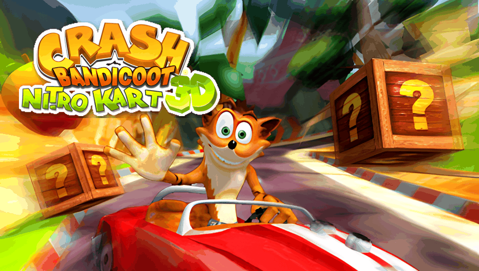

<h1 align="center">
  <br>
  Crash Nitro Kart 3D · PS Vita Port
</h1>

<p align="center">
  <a href="#-status--playability">Status & Playability</a> •
  <a href="#setup-instructions-for-players">How to install</a> •
  <a href="#controls">Controls</a> •
  <a href="#known-issues">Known Issues</a> •
  <a href="#build-instructions-for-developers">How to compile</a> •
  <a href="#credits--acknowledgments">Credits</a>
</p>

An unofficial, native **iOS-to-PS Vita wrapper port** of *Crash Bandicoot Nitro Kart 3D* (iOS 1.0, originally developed by **Polarbit** on its Fuse engine). There is no `.so` here: the port ships its own **Mach-O loader**, which maps the original 32-bit ARMv6 iOS executable (`iFuse`) into Vita RAM and replaces the Apple frameworks it uses (Foundation/UIKit, OpenGL ES 1.1, AudioQueue) with native implementations built on **vitaGL** and the Vita system libraries. The game engine runs unmodified.

---

## 🎮 Status & Playability

**Status: PLAYABLE (beta) (v01.00)**

On physical hardware the game boots, shows the language menu and the front-end menus, and runs races.

- [x] **Mach-O loader**: fixed base `MACHO_SLIDE = 0x98000000`, **2,907** rebase words (2,819 relocated at load), **171** external relocations bound. *Verified on console.*
- [x] **Graphics**: GLES 1.1 → vitaGL (`SOFTFP_ABI=1`, native `GL_FIXED` arrays). The game draws into a 320×480 portrait FBO, which is rotated onto the 960×544 screen. *Verified on console.*
- [x] **Screen modes**: fullscreen stretch (default) or the original 3:2 image with black side bars, switchable in the controls menu.
- [x] **Touch & Controls**: front touch is forwarded as iPhone touches. Buttons inject virtual touches on the HUD. The left stick simulates the iPhone accelerometer for steering.
- [x] **Controls menu**: START+SELECT opens an in-game remapping menu, modeled on the Zenonia 2 port. Settings are saved to `ux0:data/crashnitro1/config.txt`.
- [x] **Audio**: the game's AudioQueue output (22,050 Hz, mono, 16-bit) goes to the Vita audio port.
- [x] **Saves**: progress is written to `ux0:data/crashnitro1/saves/` (the iOS `Documents/` folder).
- [x] **Performance**: CPU 444 MHz / GPU 222 MHz, frame pacing on vsync (60 FPS cap). `game_run` takes about 3–5 ms per frame in races. The log prints `frame N: … fps=` every 300 frames.
- [ ] **Intro video**: `MPMoviePlayerController` is not implemented. The movie is skipped and the game continues.

---

## Disclaimer

**Crash Bandicoot** and **Crash Nitro Kart** are registered trademarks of **Activision Publishing, Inc.** The work presented in this repository is unofficial and is not produced, endorsed, or sanctioned by Activision, Polarbit or any affiliated entities.

This software does NOT contain original game code, binaries, copyrighted graphics, or game assets (see `.gitignore`). The authors do not promote or condone piracy in any way. To play, you must provide your own legally obtained, **decrypted** copy of the `.ipa`.

---

## Setup Instructions (For Players)

1. **CFW & Plugins**: PS Vita on Custom Firmware (**Enso 3.60 / 3.65** recommended) with `kubridge` in `ur0:tai/config.txt`:
   ```ini
   *KERNEL
   ur0:tai/kubridge.skprx
   ```
2. **Shader Compiler**: `libshacccg.suprx` must be in `ur0:data/` (extract it with **ShaRKBR33D**).
3. **Game Files**: a decrypted *Crash Bandicoot Nitro Kart 3D* **1.0** `.ipa` (FairPlay `cryptid 0`). Open it as a ZIP and extract `Payload/iFuse.app/`.
4. **Copy to the Vita** (`ux0:data/crashnitro1/`):
   ```
   ux0:data/crashnitro1/
     iFuse.app/    the .app folder from the IPA, untouched
     rebase.bin    generated with tools/macho_prep.py (see Build Instructions)
     config.txt    created automatically — controls and screen settings
     saves/        created automatically — your save games
     logs/         created automatically — crashnitro1_001.log … crashnitro1_999.log, one per run
   ```
5. **Install VPK**: install `crashnitro1.vpk` with VitaShell.

---

## Controls

| Input | Action | Status |
| :---: | :--- | :---: |
| **Left Stick** | Steer (simulated accelerometer tilt) | ✅ Working |
| **Cross (✖)** | Accelerate | ✅ Working |
| **Square (◼) / Circle (●)** | Brake / Drift | ✅ Working |
| **Triangle (▲)** | Use item | ✅ Working |
| **Start** | Pause | ✅ Working |
| **Start + Select** | PS Vita controls menu (pauses the game) | ⚠️ Not yet verified on console |
| **Touchscreen** | Menus and HUD (iPhone touches) | ✅ Working |

> [!TIP]
> All the buttons above can be remapped in the **Start + Select** menu: Cross replaces a binding, Square adds a button, Triangle unbinds, Circle saves and closes. The same menu sets steering direction (normal / inverted), stick deadzone and screen mode. You can also edit `ux0:data/crashnitro1/config.txt` by hand (`gas=CROSS,R`).

---

## Display Modes & Limitations

| Mode | Image | Borders |
| :--- | :--- | :--- |
| **Fullscreen** (default) | The game's 480×320 image stretched to 960×544 (slightly wider than the original aspect) | None |
| **Original 3:2** | 816×544, centered | Black bars of 72 px on each side |

---

## Known Issues

- **Intro video skipped**: there is no movie player yet. The game treats the video as finished.
- **Button positions are fixed**: each button is a virtual touch at a fixed HUD position (480×320 space). If a button has no effect on some screen, the game's button there is at a different place.
- **Opening the menu may also pause the race**: Start is bound to Pause, and Start is usually pressed a moment before Select.
- **Steering feel**: the left stick is translated into an accelerometer tilt (up to about 35°). There is no sensitivity setting other than the deadzone.
- **Crash dumps** are written by the system to `ux0:data/` (not to the game folder).

---

## Build Instructions (For Developers)

### Prerequisites

- [VitaSDK](https://vitasdk.org/) (`$VITASDK`). vitaGL is vendored in `vendor/vitaGL` and CMake builds it automatically with `SOFTFP_ABI=1`.
- CMake 3.14+, Python 3 (for the tools).
- A decrypted `iFuse.app` bundle, linked as `game_app` in the repository root (never committed).

### Compilation Commands

```bash
git clone https://github.com/MetalSyntax/Crash-Nitro-Kart-iOS-vita.git
cd Crash-Nitro-Kart-iOS-vita
ln -s /path/to/Payload/iFuse.app game_app

# rebase.bin from the decrypted executable
python3 -I tools/macho_prep.py game_app/iFuse ux0_data/crashnitro1/rebase.bin \
    --report docs/macho_report.txt

# Stage ux0_data/crashnitro1/ (clean .app + rebase.bin)
sh tools/stage_data.sh

cmake -S . -B build
cmake --build build
```

### Deploy & Debug

```bash
# Game data over FTP (VitaShell, port 1337); saves/ is never overwritten
python3 -I tools/deploy_data.py --ip <vita-ip>

# Or with psvita-toolkit
psvita-toolkit deploy --eboot --yes        # eboot.bin only (fast iteration)
psvita-toolkit analyze logs/<dump>.psp2dmp # analyze a crash dump
```

To map a guest address from a dump to the original binary, subtract the guest base `0x98000000` and look it up in `otool -tV game_app/iFuse`. Architecture and progress notes: [`PORTING_PLAN.md`](PORTING_PLAN.md) and [`port_progress.md`](port_progress.md) (in Spanish).

Project rules (see `CLAUDE.md`): **one bug per console run, driven by logs**; nothing from the IPA goes into git.

---

## Credits & Acknowledgments

- **Crash Bandicoot Nitro Kart 3D** is intellectual property of **Activision**, built by **Polarbit** on the Fuse engine.
- **vitaGL** graphics library by [Rinnegatamante](https://github.com/Rinnegatamante/vitaGL).
- **kubridge** plugin by [Bythos](https://github.com/bythos14/kubridge).
- Controls menu design from the [Zenonia 2 PS Vita port](https://github.com/MetalSyntax/Zenonia2-psvita-port). Mach-O loader from the [Skater Nation PS Vita port](https://github.com/MetalSyntax/Skater-Nation-vita).
- 8×8 menu font from the PSP/Vita debugScreen (BSD license).
- Special thanks to the PS Vita homebrew and porting community.

---

## ☕ Support My Work

This project is **free** and will stay free. If you enjoy it, a tip from **$1** helps me keep porting games to the PS Vita:

<p align="center">
  <a href="https://ko-fi.com/metalsyntax"></a>
</p>

- **Ko-fi:** [ko-fi.com/metalsyntax](https://ko-fi.com/metalsyntax)
- **PayPal:** [paypal.me/MetalSyntax](https://paypal.me/MetalSyntax)
- **Bitcoin (BTC):** `133HdCsaWxdjTfmwpgGVykByhNBV338uRc`

**Ko-fi supporters get:**
- **Early access** to new ports before their public release (test builds of upcoming projects).
- **Data preparation scripts and step-by-step guides** to set up your own game files for each new port.
- A say in which games I port next.

> Game files are never distributed. You always need your own legally obtained copy of the game.
